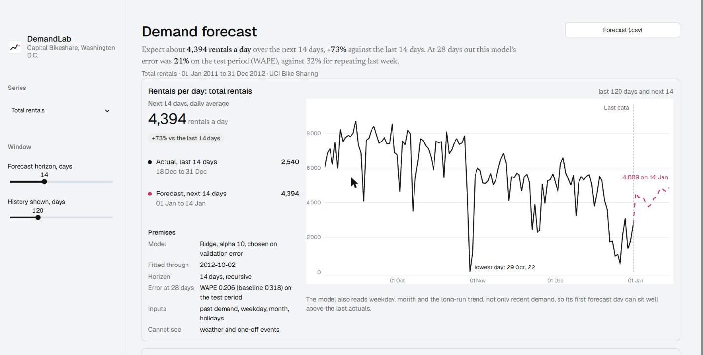

# DemandLab

Daily demand forecasting on real public data, with an honest answer to "how wrong can this be?" and a small app for testing capacity against the forecast.

[](https://github.com/abiliocoe-source/demandlab/actions/workflows/ci.yml)

[](LICENSE)



[Leia em português](README.pt-BR.md)

## Why

Anyone planning staff, stock or vehicles is working from a guess about next week's demand. A forecast helps, but a single number with no error attached invites overconfidence. The useful version says what to expect, how far off it has been in the past, and whether it beats the simplest possible rule.

The data is the [UCI Bike Sharing dataset](https://archive.ics.uci.edu/dataset/275/bike+sharing+dataset): 731 days of rentals from Capital Bikeshare in Washington D.C., 2011 and 2012. It's small, public and messy enough to be interesting, with a growth trend, strong seasons and a hurricane in the test period.

## Results

Three series are modelled (total, registered and casual riders). For each one, a seasonal-naive baseline ("same weekday last week") competes with two Ridge regressions, a random forest and gradient boosting. The model is chosen on validation error, then scored once on the last 90 days, which no model saw during selection.

Test error for total rentals, as WAPE (lower is better):

| Model | WAPE |
|---|---|
| Same weekday last week (baseline) | 0.281 |
| **Ridge, alpha 10 (chosen)** | **0.247** |
| Ridge, alpha 1 | 0.248 |
| Gradient boosting | 0.325 |
| Random forest | 0.371 |

Over a 28-day horizon the gap widens: 0.206 for Ridge against 0.318 for the baseline. Ridge also won for the other two series. Every number is in [reports/metrics.csv](reports/metrics.csv) and [reports/results.json](reports/results.json).

Two things in that table deserve a comment. Test error is roughly double the validation error (0.247 vs 0.110), because the test period runs from autumn into winter, when demand falls, and the models mostly learned a rising trend. And both tree models lost to the baseline; my guess is that they can't extrapolate a trend beyond the values they were trained on, but I haven't tested that.

## How it avoids leaking the future

Every demand feature for day *t* uses data from day *t-7* or earlier: demand 7 and 14 days back, and the mean of days *t-13* to *t-7*. The rest are calendar features (weekday, month as sine and cosine, holiday flag, a day counter). A test adds a huge value to every day from *t-6* onwards and checks that the features for day *t* don't change.

The split is chronological: training until 4 July 2012, validation for the next 90 days, test for the final 90. Forecasts longer than seven days are recursive, feeding earlier predictions back in, so error grows with the horizon.

## The app

The Streamlit app forecasts the days after the dataset ends (from January 2013). You pick a series, a horizon between 7 and 28 days and how much history to show. Under the title, one sentence states the expected daily average and the model's measured error at 28 days.

Below that is the model table, where each model's test error is drawn as a dot on a 0 to 0.6 ruler with a tick for the baseline. If a dot sits left of the tick, that model beats repeating last week.

The last card is a what-if: set a daily capacity and push demand up or down by a percentage, and it shows how many days go over and how much demand goes unmet. Those inputs are yours, and the app labels them that way.

## Running it

```bash
git clone https://github.com/abiliocoe-source/demandlab.git
cd demandlab
python -m venv .venv && source .venv/bin/activate   # Windows: .venv\Scripts\activate
pip install -r requirements.txt
streamlit run app.py
```

The trained models are committed (about 27 KB each), so the app works straight after cloning. They were saved with scikit-learn 1.9.1, which is why `requirements.txt` pins the 1.9 line.

To retrain, run the tests or rebuild the notebook:

```bash
pip install -r requirements-dev.txt
python -m demandlab.train        # about 40 s; rewrites models/ and reports/
python -m pytest -q
python scripts/make_notebook.py  # builds and runs notebooks/demandlab.ipynb
```

## Project layout

```
demandlab/
  data.py      loads day.csv, checks for gaps and negatives, temporal split
  analysis.py  trend, weekday/month profiles, anomaly detection
  features.py  lag and calendar features
  models.py    the baseline and the four candidates
  train.py     selection on validation, scoring on test, saves models and reports
  predict.py   loads a saved model and forecasts N days ahead
  metrics.py   MAE, RMSE, WAPE
app.py, ui.py  Streamlit app
```

## Limitations

The model has no weather input. The worst days in the test set are 29 and 30 October 2012, with 22 and 1,096 rentals against roughly 6,400 predicted. That's when Hurricane Sandy hit the East Coast, which is a plausible explanation, though I didn't check it against the weather columns. Two years of one city is also very little history: the model has seen each season only twice.

Next on the list: weather as an input known in advance, prediction intervals instead of a single line, and rolling-origin cross-validation.

More detail in the [model card](MODEL_CARD.md) and the [data source notes](data/SOURCE.md), which include the citation the dataset authors ask for. Interface notes are in [docs/DESIGN.md](docs/DESIGN.md), and [DEMO.md](DEMO.md) is a two-minute walkthrough.

## License

Code under the [MIT License](LICENSE). The dataset belongs to its authors; see [data/SOURCE.md](data/SOURCE.md).
