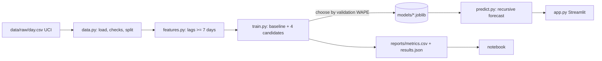
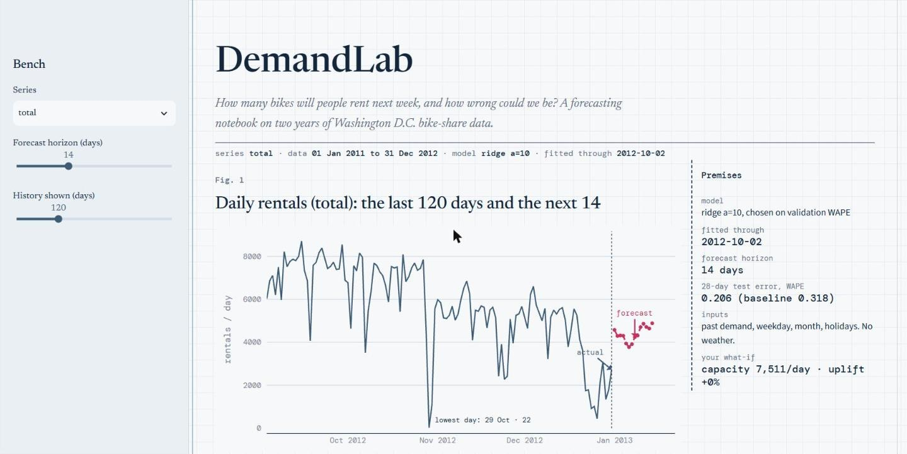
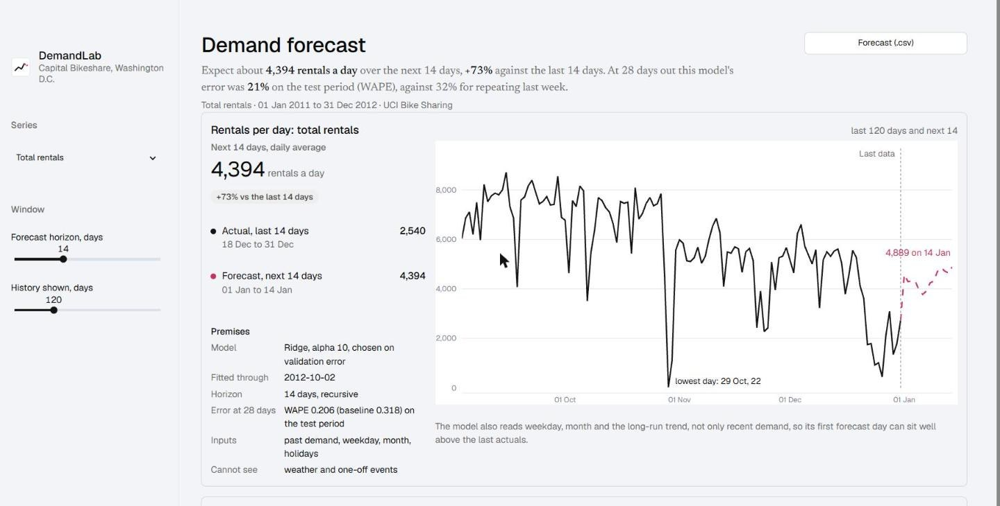
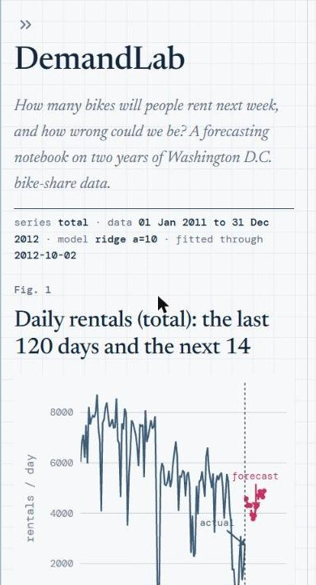
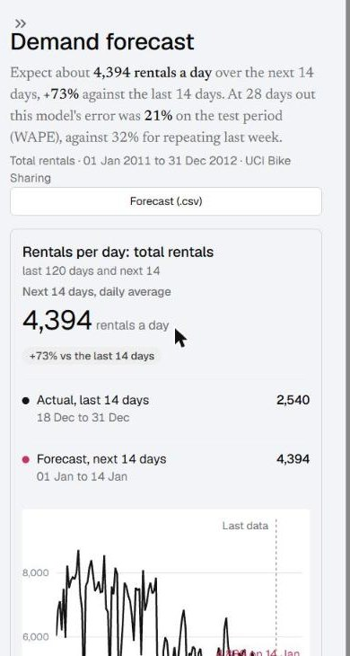

# DemandLab

Demand forecasting on a **real public dataset** (daily bike rentals, UCI Bike Sharing) with a reproducible pipeline, honest evaluation and a Streamlit what-if app. Portuguese: [README.pt-BR.md](README.pt-BR.md).

## Problem
Operations teams need a defensible forecast of next weeks' demand to plan capacity, and need to know how wrong it can be.

## Solution
Ingestion and checks -> trend/seasonality/anomaly analysis -> leakage-free features -> baseline + Ridge / RandomForest / GradientBoosting -> temporal train/validation/test split -> model chosen on validation WAPE -> saved model -> independent inference module -> Streamlit app with a capacity simulation whose assumptions are visible.

## Stack and why
pandas/NumPy (data), scikit-learn (classical models are enough and explainable), joblib (save models), Matplotlib/Jupyter (notebook), Streamlit + Plotly (app), pytest (tests). No deep learning.

## Architecture


## Run
```bash
pip install -r requirements.txt
python -m demandlab.train        # ~40 s: trains, writes models/ and reports/
streamlit run app.py
python -m pytest -q
python scripts/make_notebook.py  # optional, needs requirements-dev.txt
```
Trained models are committed (27 KB each) so the app runs right after cloning; retraining overwrites them.

## Design
Art direction (taste-skill style `achromatic-ledger`, applied inside Streamlit): a laboratory report. The chrome has no colour; history is drawn in ink and the forecast owns the one hue (crimson), dashed and labelled at its end. The screen answers one question first (how many rentals to expect and how wrong the forecast can be), with the finding written under the title from the forecast and from the measured test error. The error ruler is a column of the model table: each model is a dot on a 0 to 0.6 WAPE track and a tick marks the baseline, so "better than repeating last week" is seen, not read. Premises sit inside the chart card. Type is Geist, with Newsreader only for the title and the finding.

| Before | After |
|---|---|
|  |  |
|  |  |

More: [error ruler and what-if](docs/screenshots/after/desktop-1440-error-ruler.jpg), [error ruler on a phone](docs/screenshots/after/mobile-390-error-ruler.jpg). No external images are used, so there is nothing to credit.
Checked with the skill's linter and inspector (0 FAIL; the one warning is Streamlit's own icon font counted as a third typeface on phones) and by eye in Chrome at 1440 and 390 px. The inspector was run on a copy with longer wait times so Streamlit could finish rendering. On a phone the model table becomes two-line rows and the premises move below the chart. Keyboard use and screen readers were not tested with assistive technology. Known flaws: on a phone the end label of the forecast touches the line, and on a phone the ruler rows look like slider controls (a note under the table explains them).

## Method (what to say in an interview)
- **Target:** daily rentals, 3 series (total, registered, casual). 731 days.
- **No leakage:** every demand feature uses data from at least 7 days earlier; a test proves that changing recent demand does not change a day's features. Split is chronological: train to 2012-07-04, validation to 2012-10-02, test 2012-10-03..12-31 (90 days each for val/test).
- **Selection:** by validation WAPE only. Then models are refit on train+validation and scored once on test.
- **Metrics:** MAE, RMSE, WAPE (= sum|error| / sum|actual|; NaN if the denominator is 0).
- **Baseline:** same weekday last week.

## Measured results (test set, WAPE; lower is better)
| model | total | registered | casual |
|---|---|---|---|
| seasonal-naive (baseline) | 0.281 | 0.277 | 0.501 |
| ridge (alpha 1) | 0.248 | 0.230 | **0.430** |
| ridge (alpha 10) | **0.247** | **0.231** | 0.430 |
| random forest | 0.371 | 0.268 | 0.516 |
| gradient boosting | 0.325 | 0.244 | 0.471 |

Chosen on validation: `ridge_a10` (total, registered), `ridge_a1` (casual). Test MAE for `total`: 1,272 vs 1,450 (baseline). 28-day recursive test WAPE (7 origins): total 0.206 vs 0.318 baseline. Everything is in `reports/metrics.csv` and `reports/results.json`.

## Failure cases and limitations
- Test error is about 2x validation error for `total` (0.247 vs 0.110): test is autumn-to-winter and only two years exist. Tree models do worse than Ridge, probably due to the rising trend (hypothesis, untested).
- Worst days: 2012-10-29 and 10-30 (22 and 1,096 actual vs ~6,400 predicted) and 2012-12-26. A storm is a plausible cause but not verified; the model uses no weather.
- Only one city and 2 years; see `data/SOURCE.md` (source, citation requirement, limitations). Forecasts beyond 7 days are recursive and less accurate.

## Hugging Face Hub
`MODEL_CARD.md` and `python scripts/export_hf.py` prepare `hf_repo/`. **Nothing is published.**

## LLM
This project uses no LLM: it is classical forecasting with scikit-learn, with no adapter and no API key involved.

## Next steps
Weather as a known-in-advance input, prediction intervals, more history, rolling-origin cross-validation.
