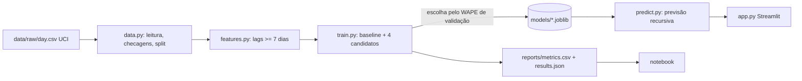

# DemandLab

Previsão de demanda com um **dataset público real** (aluguel diário de bicicletas, UCI Bike Sharing), pipeline reproduzível, avaliação honesta e app Streamlit de simulação. English: [README.md](README.md).

## Problema
Times de operação precisam de uma previsão defensável das próximas semanas para planejar capacidade, e precisam saber o quanto ela pode errar.

## Solução
Ingestão e checagens -> análise de tendência/sazonalidade/anomalias -> features sem vazamento -> baseline + Ridge / RandomForest / GradientBoosting -> split temporal treino/validação/teste -> modelo escolhido pelo WAPE de validação -> modelo salvo -> módulo de inferência independente -> app Streamlit com simulação de capacidade e premissas visíveis.

## Stack e justificativas
pandas/NumPy (dados), scikit-learn (modelos clássicos bastam e são explicáveis), joblib (salvar modelos), Matplotlib/Jupyter (notebook), Streamlit + Plotly (app), pytest (testes). Sem deep learning.

## Arquitetura


## Execução
```bash
pip install -r requirements.txt
python -m demandlab.train        # ~40 s: treina e grava models/ e reports/
streamlit run app.py
python -m pytest -q
python scripts/make_notebook.py  # opcional, requer requirements-dev.txt
```
Os modelos treinados estão versionados (27 KB cada) para o app rodar logo após clonar; retreinar sobrescreve.

## Design
Direção de arte (estilo `achromatic-ledger` da taste-skill, aplicado dentro do Streamlit): um relatório de laboratório. O cromo não tem cor; o histórico é desenhado em tinta e a previsão tem o único matiz (carmim), tracejada e rotulada no fim. A tela responde primeiro uma pergunta (quantos aluguéis esperar e o quanto a previsão pode errar), com o achado escrito sob o título a partir da previsão e do erro de teste medido. A régua de erro é uma coluna da tabela de modelos: cada modelo é um ponto numa trilha de WAPE de 0 a 0,6 e um traço marca o baseline, então "melhor que repetir a semana passada" é visto, não lido. As premissas ficam dentro do cartão do gráfico. A tipografia é Geist, com Newsreader só no título e no achado.

| Antes | Depois |
|---|---|
|  |  |
|  |  |

Mais: [régua de erro e simulador](docs/screenshots/after/desktop-1440-error-ruler.jpg), [régua de erro no celular](docs/screenshots/after/mobile-390-error-ruler.jpg). Não há imagens externas, então não há créditos.
Conferido com o linter e o inspetor da skill (0 FAIL; o único aviso é a fonte de ícones do próprio Streamlit contada como terceira fonte no celular) e a olho no Chrome em 1440 e 390 px. O inspetor rodou numa cópia com esperas maiores para o Streamlit terminar de renderizar. No celular a tabela de modelos vira linhas de duas linhas e as premissas descem para depois do gráfico. Teclado e leitores de tela não foram testados com tecnologia assistiva. Defeitos conhecidos: no celular o rótulo final da previsão encosta na linha, e as linhas da régua parecem controles deslizantes (uma nota sob a tabela as explica).

## Método (o que dizer em entrevista)
- **Alvo:** aluguéis diários, 3 séries (total, registrados, casuais). 731 dias.
- **Sem vazamento:** toda feature de demanda usa dados de pelo menos 7 dias antes; um teste prova que mudar a demanda recente não altera as features do dia. Split cronológico: treino até 2012-07-04, validação até 2012-10-02, teste 2012-10-03..12-31 (90 dias cada).
- **Seleção:** só pelo WAPE de validação. Depois, refit em treino+validação e avaliação única no teste.
- **Métricas:** MAE, RMSE, WAPE (= soma|erro| / soma|real|; NaN se o denominador for 0).
- **Baseline:** mesmo dia da semana anterior.

## Resultados medidos (teste, WAPE; menor é melhor)
| modelo | total | registrados | casuais |
|---|---|---|---|
| seasonal-naive (baseline) | 0,281 | 0,277 | 0,501 |
| ridge (alpha 1) | 0,248 | 0,230 | **0,430** |
| ridge (alpha 10) | **0,247** | **0,231** | 0,430 |
| random forest | 0,371 | 0,268 | 0,516 |
| gradient boosting | 0,325 | 0,244 | 0,471 |

Escolhidos na validação: `ridge_a10` (total, registrados), `ridge_a1` (casuais). MAE de teste em `total`: 1.272 vs 1.450 (baseline). WAPE recursivo de 28 dias no teste (7 origens): total 0,206 vs 0,318 do baseline. Tudo em `reports/metrics.csv` e `reports/results.json`.

## Casos de falha e limitações
- O erro de teste é ~2x o de validação em `total` (0,247 vs 0,110): o teste cobre outono-inverno e há só dois anos. Modelos de árvore pioram vs Ridge, provavelmente pela tendência de alta (hipótese, não testada).
- Piores dias: 2012-10-29 e 10-30 (22 e 1.096 reais vs ~6.400 previstos) e 2012-12-26. Uma tempestade é causa plausível, mas não verificada; o modelo não usa clima.
- Uma cidade e 2 anos; veja `data/SOURCE.md` (fonte, exigência de citação, limitações). Previsões além de 7 dias são recursivas e menos precisas.

## Hugging Face Hub
`MODEL_CARD.md` e `python scripts/export_hf.py` preparam `hf_repo/`. **Nada foi publicado.**

## LLM
Este projeto não usa LLM: é previsão clássica com scikit-learn, sem adaptador e sem chave de API.

## Próximos passos
Clima como entrada conhecida com antecedência, intervalos de previsão, mais histórico, validação cruzada com origem móvel.
