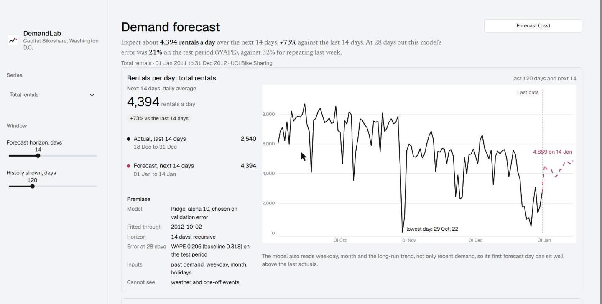

# DemandLab

Previsão de demanda diária com dados públicos reais, uma resposta honesta para "quanto isso pode errar?" e um pequeno app para testar capacidade contra a previsão.

[](https://github.com/abiliocoe-source/demandlab/actions/workflows/ci.yml)

[](LICENSE)



**Demo:** https://demandlab.streamlit.app/ · A interface está em inglês. [Read in English](README.md).

## Por quê

Quem planeja equipe, estoque ou frota trabalha com um palpite sobre a demanda da semana que vem. Uma previsão ajuda, mas um número solto, sem erro associado, convida ao excesso de confiança. A versão útil diz o que esperar, quanto ela já errou no passado e se ganha da regra mais simples possível.

Os dados são o [UCI Bike Sharing dataset](https://archive.ics.uci.edu/dataset/275/bike+sharing+dataset): 731 dias de aluguéis da Capital Bikeshare em Washington D.C., em 2011 e 2012. É pequeno, público e bagunçado o bastante para ser interessante, com tendência de crescimento, estações bem marcadas e um furacão no período de teste.

## Resultados

São modeladas três séries (total, usuários registrados e casuais). Em cada uma, um baseline sazonal ingênuo ("mesmo dia da semana passada") concorre com duas regressões Ridge, um random forest e um gradient boosting. O modelo é escolhido pelo erro na validação e depois medido uma única vez nos últimos 90 dias, que nenhum modelo viu durante a escolha.

Erro no teste para o total de aluguéis, em WAPE (menor é melhor):

| Modelo | WAPE |
|---|---|
| Mesmo dia da semana passada (baseline) | 0,281 |
| **Ridge, alpha 10 (escolhido)** | **0,247** |
| Ridge, alpha 1 | 0,248 |
| Gradient boosting | 0,325 |
| Random forest | 0,371 |

Num horizonte de 28 dias a diferença aumenta: 0,206 para o Ridge contra 0,318 do baseline. O Ridge também venceu nas outras duas séries. Todos os números estão em [reports/metrics.csv](reports/metrics.csv) e [reports/results.json](reports/results.json).

Duas coisas nessa tabela merecem comentário. O erro no teste é cerca do dobro do erro na validação (0,247 contra 0,110), porque o teste vai do outono ao inverno, quando a demanda cai, e os modelos aprenderam principalmente uma tendência de alta. E os dois modelos de árvore perderam para o baseline. Meu palpite é que eles não conseguem extrapolar uma tendência além dos valores vistos no treino, mas não testei isso.

## Como ele evita usar o futuro

Toda variável de demanda para o dia *t* usa dados do dia *t-7* ou anteriores: a demanda de 7 e 14 dias antes e a média dos dias *t-13* a *t-7*. O resto são variáveis de calendário (dia da semana, mês como seno e cosseno, feriado, um contador de dias). Um teste soma um valor enorme a todos os dias a partir de *t-6* e confere que as variáveis do dia *t* não mudam.

A divisão é cronológica: treino até 4 de julho de 2012, validação nos 90 dias seguintes e teste nos 90 finais. Previsões com mais de sete dias são recursivas, reaproveitando as previsões anteriores, então o erro cresce com o horizonte.

## O app

O app em Streamlit prevê os dias seguintes ao fim do dataset (a partir de janeiro de 2013). Você escolhe a série, um horizonte de 7 a 28 dias e quanto histórico mostrar. Abaixo do título, uma frase traz a média diária esperada e o erro medido do modelo a 28 dias.

Em seguida vem a tabela de modelos, em que o erro de teste de cada um aparece como um ponto numa régua de 0 a 0,6, com um traço marcando o baseline. Se o ponto fica à esquerda do traço, o modelo ganha de repetir a semana passada.

O último cartão é um "e se": você define a capacidade diária e aumenta ou reduz a demanda em porcentagem, e ele mostra quantos dias passam do limite e quanta demanda fica sem atendimento. Essas premissas são suas, e o app deixa isso escrito.

## Como rodar

```bash
git clone https://github.com/abiliocoe-source/demandlab.git
cd demandlab
python -m venv .venv && source .venv/bin/activate   # Windows: .venv\Scripts\activate
pip install -r requirements.txt
streamlit run app.py
```

Os modelos treinados estão no repositório (cerca de 27 KB cada), então o app funciona logo depois de clonar. Eles foram salvos com o scikit-learn 1.9.1, por isso o `requirements.txt` fixa a versão 1.9.

Para retreinar, rodar os testes ou refazer o notebook:

```bash
pip install -r requirements-dev.txt
python -m demandlab.train        # cerca de 40 s; regrava models/ e reports/
python -m pytest -q
python scripts/make_notebook.py  # monta e executa notebooks/demandlab.ipynb
```

## Estrutura

```
demandlab/
  data.py      lê day.csv, procura dias faltando e valores negativos, divide no tempo
  analysis.py  tendência, perfis por dia da semana e mês, detecção de anomalias
  features.py  variáveis de defasagem e de calendário
  models.py    o baseline e os quatro candidatos
  train.py     escolha na validação, medição no teste, salva modelos e relatórios
  predict.py   carrega um modelo salvo e prevê N dias à frente
  metrics.py   MAE, RMSE, WAPE
app.py, ui.py  app em Streamlit
```

## Limitações

O modelo não usa clima. Os piores dias do teste são 29 e 30 de outubro de 2012, com 22 e 1.096 aluguéis contra cerca de 6.400 previstos. Foi quando o furacão Sandy atingiu a costa leste dos EUA, o que é uma explicação plausível, mas não conferi com as colunas de clima. Dois anos de uma única cidade também é pouco histórico: o modelo viu cada estação só duas vezes.

Próximos passos: clima como variável conhecida com antecedência, intervalos de previsão em vez de uma linha só e validação cruzada com origem móvel.

Mais detalhes no [model card](MODEL_CARD.md) e nas [notas sobre a fonte dos dados](data/SOURCE.md), que incluem a citação pedida pelos autores do dataset. As notas de interface estão em [docs/DESIGN.md](docs/DESIGN.md), e o [DEMO.md](DEMO.md) tem um roteiro de dois minutos.

## Licença

Código sob a [licença MIT](LICENSE). O dataset pertence aos seus autores; veja [data/SOURCE.md](data/SOURCE.md).
