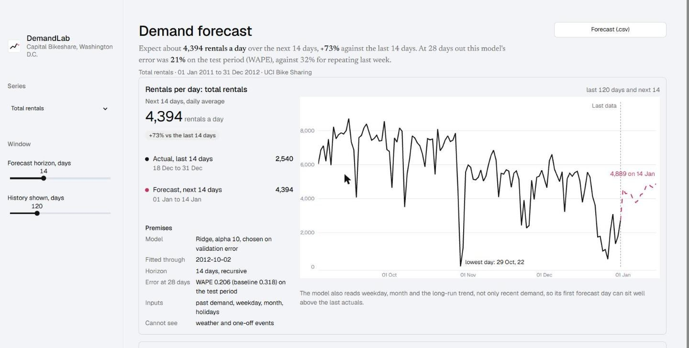
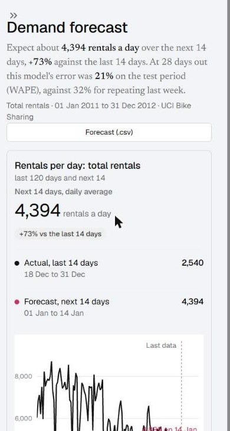
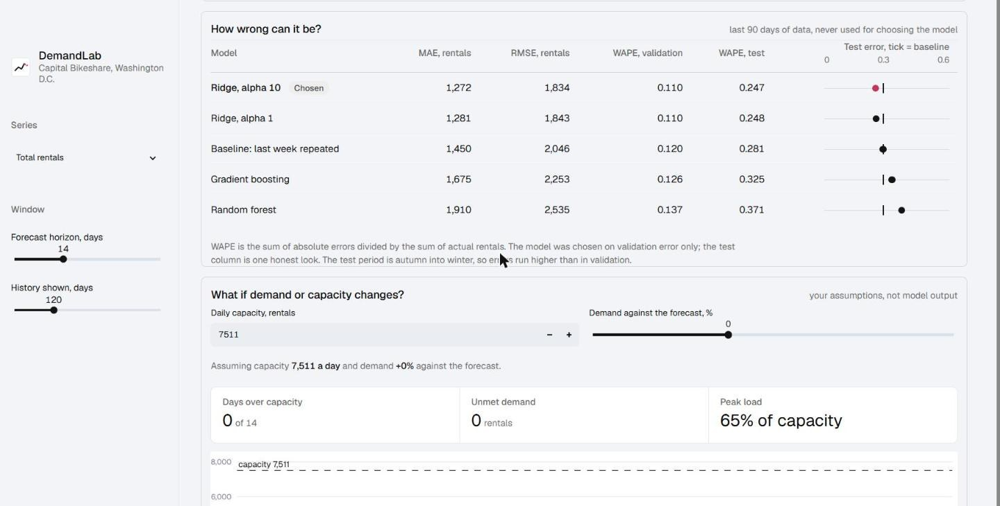
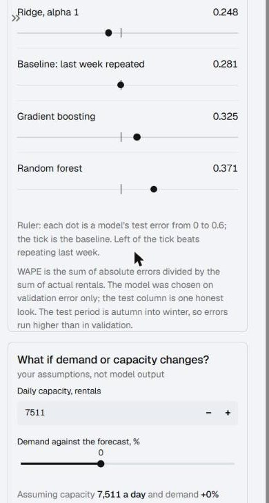

# Interface notes

The app is laid out like a lab report. The interface itself has no colour: history is drawn in ink, and the forecast is the only thing in a colour (crimson), dashed and labelled where it ends. Type is Geist, with Newsreader used only for the title and the one-sentence finding under it.

The screen is meant to answer one question first: how many rentals to expect, and how wrong that number might be. The sentence under the title is built from the forecast and from the measured test error, so it changes with the series and the horizon.

The model table has an extra column, the error ruler. Each model is a dot on a 0 to 0.6 WAPE track, and a tick marks the baseline. "Better than repeating last week" becomes something you see rather than a number you compare. The assumptions behind the forecast (horizon, training cut-off, what the model doesn't know) sit inside the chart card instead of in a separate section.

## Screenshots

| Desktop | Phone |
|---|---|
|  |  |
|  |  |

## What I checked and what I didn't

Checked by eye in Chrome at 1440 px and 390 px wide. On a phone the model table becomes two-line rows and the assumptions move below the chart.

Two known flaws on phones: the label at the end of the forecast line touches the line, and the ruler rows can look like sliders. A note under the table explains what they are.

Keyboard navigation and screen readers were not tested with assistive technology.
